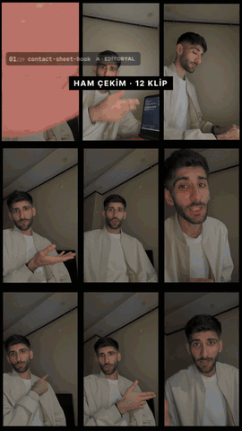
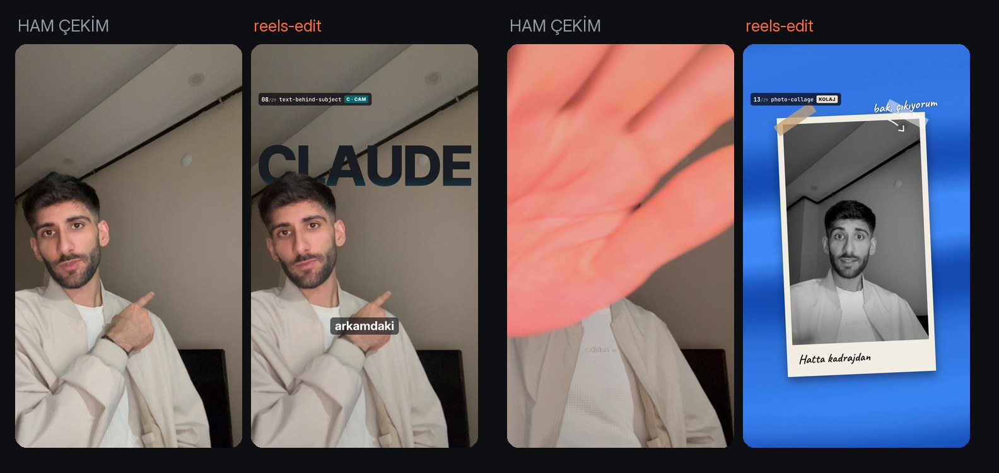
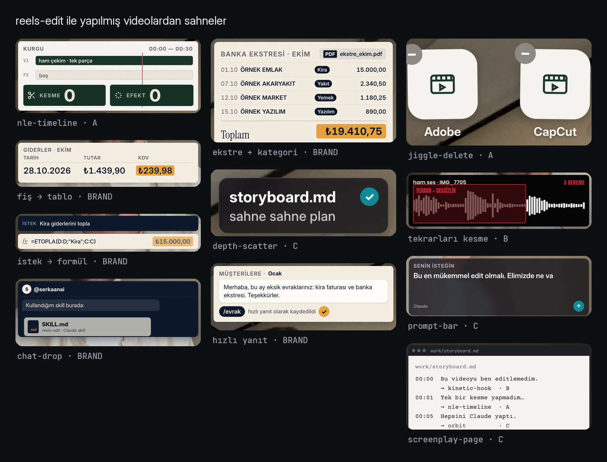
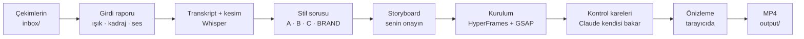
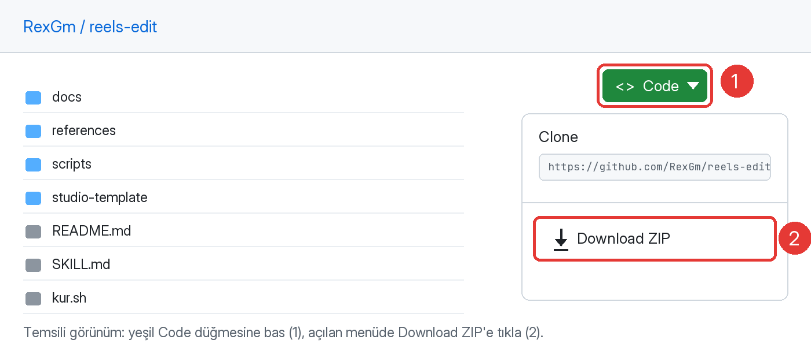
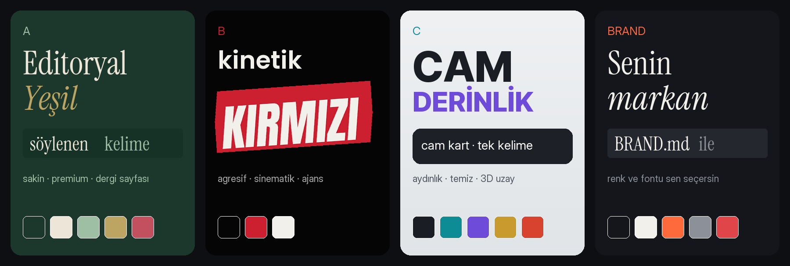

# reels-edit

Telefonla çektiğin konuşma videosunu Claude'a ver; **altyazılı, efektli, müzikli bir Reels / TikTok / Shorts videosu** olarak geri al.

Bu bir [Claude Code](https://claude.com/claude-code) skill'i. Videoyu Claude izler, gereksiz yerleri keser, storyboard'u yazıp onayına sunar, sonra [HyperFrames](https://hyperframes.heygen.com) ile 1080×1920 MP4 olarak render eder. Sen tek bir kesme bile yapmazsın.

<p align="center">
  
</p>
<p align="center"><sub>Bu video baştan sona bu skill'le editlendi: 29 efekt, 5 stil, elle tek bir kesme yok.</sub></p>

> **Kısaca kurulum:** [1) Programları kur](#adım-1--gerekli-programları-kur) → [2) Claude Code'u kur](#adım-2--claude-codeu-kur) → [3) Bu repoyu indir](#adım-3--bu-repoyu-indir) → [4) `kur.sh`'yi çalıştır](#adım-4--kurulum-betiğini-çalıştır) → [5) İlk videon](#adım-5--ilk-videon)
>
> GitHub'ı ya da Terminal'i hiç kullanmadıysan sorun değil; her adımı tek tek anlattım.

---

## İçindekiler

- [Ne yapar](#ne-yapar)
- [Nasıl çalışır](#nasıl-çalışır)
- [Neye ihtiyacın var](#neye-ihtiyacın-var)
- [Kurulum (adım adım)](#kurulum-adım-adım)
- [Kullanım: Claude'a ne yazarsın](#kullanım-claudea-ne-yazarsın)
- [İyi çekim için 8 ipucu](#iyi-çekim-için-8-ipucu)
- [Stiller](#stiller)
- [Efektler](#efektler)
- [Ses: müzik, efekt sesi, gürültü temizliği](#ses-müzik-efekt-sesi-gürültü-temizliği)
- [Kendi görünümün: BRAND.md](#kendi-görünümün-brandmd)
- [Klasör yapısı](#klasör-yapısı)
- [Windows'ta kurulum](#windowsta-kurulum)
- [Sorun giderme](#sorun-giderme)
- [Güncelleme ve kaldırma](#güncelleme-ve-kaldırma)
- [Sık sorulanlar](#sık-sorulanlar)
- [Lisanslar ve teşekkür](#lisanslar-ve-teşekkür)

---

## Ne yapar

- **Keser.** Sessizlikleri, "ııı"ları, tekrar aldığın cümleleri bulur ve çıkarır. Aynı cümleyi üç kez çektiysen en iyisini seçer.
- **Türkçe altyazı yazar.** Kelime kelime, söylendiği anda yanan altyazı. `İ Ş Ğ Ü` doğru büyük harfle. Marka adlarını (Claude, ChatGPT, CapCut…) düzeltir.
- **Sahneyi kurar.** Kafanın arkasında dev yazı, yanında beliren kartlar, avucunda duran grafik, telefona dalan görüntü, kâğıt fotoğraftan dışarı taşan el. Arayüz kartları, sayaçlar, ekran kayıtları da var.
- **Rengi ayarlar.** Videoya stilin rengini verir, iPhone'un HDR çekimini soluk göstermeden dönüştürür.
- **Ses işini halleder.** Arkadaki uğultuyu temizler, konuşmayı -14 LUFS'a getirir. Telifsiz müzik ve efekt sesi üretir, müziği konuşmanın altına oturtur.
- **Onayını bekler.** Storyboard'u görmeden ve "onaylıyorum" demeden final videoyu render etmez.
- **Öğrenir.** Ürettiği yazıları, şablonları ve sesleri kütüphanende saklar, bir sonraki videoda tekrar kullanır. Beğendiğin bir videoyu verirsen stilini çıkarıp aynısını senin çekiminle kurar.

<p align="center">
  
</p>

<p align="center">
  
</p>

## Nasıl çalışır



1. **Girdi raporu:** her klibin ışığını, kafanın kadrajdaki yerini, sesini ölçer. Hangi stilin bu çekime uyduğunu söyler.
2. **Transkript ve kesim:** konuşmayı yazıya döker, boşlukları ve tekrarları keser. Emin olmadığı kelimeyi sana sorar.
3. **Stil:** sana dört stil sunar, birini önerir. İstersen karıştırırsın.
4. **Storyboard:** hangi saniyede hangi efektin geleceğini bir tabloda gösterir. Değiştirmek istediğini söylersin.
5. **Kurulum ve kontrol:** videoyu kurar, kendi ürettiği karelere bakıp hataları (yüzü kapatan kart, okunmayan yazı) düzeltir.
6. **Önizleme ve render:** tarayıcıda izlersin; "onaylıyorum" dediğinde MP4 çıkar.

## Neye ihtiyacın var

| | |
|---|---|
| **Bilgisayar** | Mac (Apple Silicon ya da Intel). Windows ve Linux'ta da çalışır, ama asıl Mac'te test edildi. |
| **Claude hesabı** | Claude Code'u kullanabilen ücretli bir hesap: **Claude Pro** ya da **Max** (veya API hesabı). |
| **Boş disk** | En az 10 GB. Konuşmayı yazıya döken model ~3 GB, render sırasında geçici dosyalar birkaç GB tutar. |
| **İnternet** | Kurulumda ve ilk transkriptte (model iner). Sonrası bilgisayarında çalışır. |
| **Süre** | İlk kurulum 15–30 dk. Bir video: 30–60 sn'lik çekim için genelde 30–90 dk, çoğu bekleme. |

## Kurulum (adım adım)

### Adım 0 — Terminal'i aç

Kurulumu **Terminal**'e komut yazarak yapacağız. Korkma, komutları kopyalayıp yapıştıracaksın.

- **Mac:** `Cmd ⌘ + Boşluk` tuşlarına bas, açılan aramaya `Terminal` yaz, `Enter`.
- Aşağıdaki gri kutulardaki komutu kopyala, Terminal'e yapıştır (`Cmd ⌘ + V`), `Enter`'a bas.
- Komut bitince satırın başında yeniden yazı yazabileceğin bir imleç belirir. Sonraki komuta geçebilirsin.
- **Şifre sorarsa** Mac'ine giriş yaptığın şifreyi yaz. Yazarken ekranda hiçbir şey görünmez, bu normal. Yaz ve `Enter`'a bas.

### Adım 1 — Gerekli programları kur

Önce **Homebrew** (Mac için program yükleyici). Bu komutu yapıştır:

```bash
/bin/bash -c "$(curl -fsSL https://raw.githubusercontent.com/Homebrew/install/HEAD/install.sh)"
```

> Kurulumun sonunda **"Next steps"** başlığı altında bir-iki komut yazarsa onları da kopyalayıp çalıştır. Bu komutlar `brew`'u kullanılabilir hâle getirir.

Sonra videonun ihtiyaç duyduğu programlar:

```bash
brew install node ffmpeg python git
```

- **node**: video motoru HyperFrames bununla çalışır.
- **ffmpeg**: video ve sesi keser, birleştirir, ölçer.
- **python**: ölçüm, takip ve kolaj betikleri.
- **git**: indirme ve güncelleme için.

### Adım 2 — Claude Code'u kur

[claude.com/claude-code](https://claude.com/claude-code) sayfasındaki kurulum komutunu çalıştır. Şu an şöyle:

```bash
curl -fsSL https://claude.ai/install.sh | bash
```

Olmazsa (Node kurulu olduğu için) şu da çalışır:

```bash
npm install -g @anthropic-ai/claude-code
```

Sonra Terminal'e `claude` yazıp `Enter`'a bas. Tarayıcı açılır, Claude hesabınla giriş yap. Giriş bitince Claude Code'dan çıkmak için `Ctrl + C`'ye iki kez bas.

### Adım 3 — Bu repoyu indir

GitHub'ı hiç kullanmadıysan:

1. Bu sayfanın en üstüne çık.
2. Yeşil **`<> Code`** düğmesine bas.
3. Açılan menünün altındaki **Download ZIP**'e tıkla.

<p align="center">
  
</p>

4. İnen dosya **İndirilenler** klasörüne gelir: `reels-edit-main.zip`. Üstüne çift tıkla, `reels-edit-main` adında bir klasör açılır.

> Git kullanmayı biliyorsan: `git clone https://github.com/RexGm/reels-edit.git`

### Adım 4 — Kurulum betiğini çalıştır

Terminal'de indirdiğin klasöre gir ve betiği çalıştır:

```bash
cd ~/Downloads/reels-edit-main
bash kur.sh
```

> Mac'in dili Türkçeyse Finder'da klasörün adı "İndirilenler" görünür; Terminal'de yine `Downloads` yazılır.

Betik şunları yapar:

1. Gerekli programların kurulu olduğunu kontrol eder. Eksik varsa ne kuracağını söyler.
2. Python paketlerini kurar (görüntü ölçümü, takip, kolaj).
3. Skill'i Claude'un bulacağı yere kopyalar: `~/.claude/skills/reels-edit`.
4. Video stüdyonu açar: `~/Movies/reels-studio`. Çekimlerin, projelerin ve bitmiş videoların burada durur.
5. HyperFrames'in kendi skill'lerini kurar (video motorunun kuralları).
6. Arka plan gürültüsünü temizleyen küçük modeli indirir.
7. Her şeyin çalıştığını kontrol eder.

Sonunda **"Bitti 🎬"** yazısını görmelisin.

**Kodla müzik ve efekt sesi üretimi de istiyorsan** (önerilir, ~1 GB):

```bash
bash kur.sh --muzik
```

Bu, telifsiz müzik ve "kâğıt hışırtısı, daktilo, whoosh" gibi efekt seslerini videonun anlarına kilitli üreten **mgaudio**'yu kurar. Kurmazsan Claude müziksiz render alır; müziği Instagram'dan eklersin.

### Adım 5 — İlk videon

1. **Çekimlerini koy.** Finder'da `Git › Ana Klasör › Filmler › reels-studio › inbox` klasörüne git. İçinde yeni bir klasör aç (örneğin `ilk-video`) ve çekimlerini oraya at. Her cümleyi ayrı klip çektiysen hepsini koy, sırayı Claude anlar.
2. **Claude'u stüdyonda başlat.** Terminal'e:

   ```bash
   cd ~/Movies/reels-studio
   claude
   ```

3. **Ne istediğini yaz:**

   ```
   inbox/ilk-video klasöründeki çekimleri editle
   ```

Sonrasında Claude:

- çekimleri ölçer ve konuşmayı yazıya döker (**ilk seferde** konuşma modeli ~3 GB iner, birkaç dakika sürer);
- emin olmadığı kelimeleri sorar;
- sana stil seçenekleri sunar;
- storyboard'u gösterir ve onayını bekler;
- videoyu kurar, önizleme bağlantısı verir;
- "onaylıyorum" dediğinde videoyu `reels-studio/output/` klasörüne koyar.

> Claude bir komut çalıştırmadan önce izin isteyebilir. Ne yapacağını okuyup onaylayabilirsin.

## Kullanım: Claude'a ne yazarsın

Normal konuşur gibi yaz. Birkaç örnek:

| Ne istiyorsun | Claude'a yaz |
|---|---|
| İlk edit | `inbox/03 klasöründeki çekimleri editle, hook en başta olsun` |
| Stil seçmek | `Bu videoda B stilini kullan` · `Stilleri karıştır, her bölüm farklı olsun` |
| Müzik | `Müziği sen koy` · `Müzik koyma, Instagram'dan trend ses ekleyeceğim` |
| Efekt istemek | `Kafamın arkasına dev MUHASEBECİ yazısı koy` · `Önceki videolarım kafamın etrafında dönsün` |
| Gürültü | `Arkadan ses geliyor, gürültüyü temizle` |
| Değişiklik | `Storyboard'da 3. sahnede kart yerine dev yazı olsun` · `Altyazıda "Edok" değil "Adobe" diyorum` |
| Tekrarlı çekim | `Elini lense uzattığın kısmı 3 kez çektim, en iyisini seç` |
| Kopya | `references/videos/begendim.mp4 bu videodaki gibi yap` |
| Kütüphane | `Bu kolaj sahnesini kütüphaneye kaydet` · `Kütüphanemde ne var?` |

## İyi çekim için 8 ipucu

1. **4K, 30 fps, HDR kapalı.** iPhone: `Ayarlar › Kamera › Video Kaydı` ve `HDR Video`'yu kapat. HDR açıksa da çalışır, ama dosya büyür.
2. **Tripod ve göz hizası.** Telefon dikey.
3. **Pozlamayı kilitle.** Ekranda yüzüne basılı tut (AE/AF Kilidi). Yoksa duvar parlayıp söner.
4. **Kafanın üstünde boşluk bırak.** Kadrajın ~%30'u. Dev yazılar ve kartlar oraya oturur.
5. **Düz duvar, düz kıyafet.** Arkada kafa hizasında eşya, üstünde büyük logo ya da yazı olmasın.
6. **Her cümle ayrı klip.** Kayda bastıktan sonra 1 sn bekle, cümle bitince 1 sn kıpırdama.
7. **Efekt hareketleri çek.** Telefonu kameraya tutmak, avucunu açmak, yana işaret etmek, eli lense uzatmak efektler için malzemedir. Claude çekimden önce hangi hareketi nasıl yapacağını söyleyebilir: `Bu senaryo için hangi açılardan çekmeliyim?` diye sor.
8. **Ekran kaydı ekle.** Konuştuğun uygulamanın ekran kaydını da `inbox`'a koyarsan Claude onu videoya pencere olarak yerleştirir.

## Stiller

<p align="center">
  
</p>

| Stil | His | Ne zaman |
|---|---|---|
| **A · Editoryal Yeşil** | Sakin, premium, dergi sayfası. Kutulu serif altyazı, arayüz kartları. | Bilgilendirici, öğretici videolar |
| **B · Kinetik Kırmızı** | Agresif, sinematik. Kırmızı bloklu dev yazılar, hızlı kesme, sarsıntı. | Satış, iddialı ya da enerjik videolar |
| **C · Cam Derinlik** | Aydınlık, temiz. Cam kartlar, 3D uzay, tek kelime altyazı. | Ürün, mekân, lüks his |
| **BRAND** | Senin kendi görünümün (`BRAND.md`). | Kanalının düzenli videoları |
| **Karışım** | Her bölüm farklı stil. | Gösteri ve "neler yapabiliyorum" videoları |

Claude her videoda çekime bakıp birini önerir, son karar senin. Ölçülmüş değerler (renk kodları, fontlar, altyazı ölçüleri): [`references/styles.md`](references/styles.md).

## Efektler

95'ten fazla efektin tarifi [`references/effects.md`](references/effects.md)'de. Bazıları:

- **Kamera:** snap-zoom, punch-in, whip-pan, dolly-zoom, over-shoulder-zoom, siyah-beyaz ve beyaz flaş, bulanık geçiş
- **Kişi maskesi:** kafanın arkasında dev yazı (text-behind-subject), kadrajdan taşan el (frame-escape), omuz arkasından çıkan görsel, etrafında dönen kartlar (orbit), derinlikte cam kartlar
- **Yazı:** kinetik kanca, karaoke altyazı, pill altyazı, serif damga, kelime kelime belirme, sayaç
- **Arayüz:** prompt kutusu, kurgu çizelgesi, sohbet ve DM, bildirim yığını, yorum kutusu, takip düğmesi, telefon çerçevesi, ekran kaydı penceresi
- **Kâğıt ve kolaj:** kesik kâğıt figür, saten zemin, washi bant, kâğıt fotoğraf, el yazısı not
- **Görünüm:** film greni, sinematik grade, önce/sonra kaydırıcısı
- **3D (Blender kuruluysa):** metal yazı, dönen ikon, telefon, tuş

Efekt istemek için adını bilmen gerekmez. `Elimde bir grafik dursun` demen yeter.

## Ses: müzik, efekt sesi, gürültü temizliği

- **Konuşma** temizlenir ve -14 LUFS'a getirilir (Instagram ve TikTok'un sevdiği seviye).
- **Gürültü temizliği:** arkadaki uğultu, klima, TV sesi [RNNoise](https://github.com/GregorR/rnnoise-models) ile azaltılır. Claude sesi duyamaz, sayılarla ölçer. **Kulak kontrolü sende.** Ses doğal gelmezse `gürültü temizliğini hafiflet` de.
- **Müzik ve efekt sesleri** (`kur.sh --muzik` ile): stile göre lofi, trap, ambient, glitch-hop gibi telifsiz müzik ve efektlere kilitli sesler üretilir. Müzik konuşmanın altında duyulur ama bastırmaz.
- **Trend ses kullanacaksan** `Müzik koyma` de; Claude yalnız konuşma ve efektle render alır, müziği uygulamadan eklersin.

## Kendi görünümün: BRAND.md

`~/Movies/reels-studio/BRAND.md` senin kanalının kuralları: renkler, fontlar, altyazı şekli, ritim, güvenli alanlar. Kurulumla gelen dosya bir **şablon**. Renkleri ve fontları değiştir; Claude her videoda bu dosyayı okur.

Elle uğraşmak istemezsen Claude'a söyle:

```
BRAND.md'deki renkleri lacivert, krem ve altın yap; başlık fontu serif olsun
```

## Klasör yapısı

```
~/Movies/reels-studio/          ← senin stüdyon
  inbox/                        ham çekimlerin (her video ayrı klasör)
  projects/<tarih>_<ad>/        her videonun çalışma klasörü
  output/                       bitmiş videolar
  library/                      tekrar kullanılan yazılar, sesler, şablonlar
  references/videos/            beğendiğin örnek videolar
  BRAND.md                      kendi görünümün
  edit-log.md                   hangi videoda ne kullanıldı (tekrarı önler)
  CLAUDE.md                     stüdyonun kuralları (Claude okur)

~/.claude/skills/reels-edit/    ← skill (kur.sh buraya kopyalar)
  SKILL.md                      iş akışı
  references/                   stiller, efektler, malzeme listesi, Blender, müzik
  scripts/                      ölçüm, takip, kolaj, müzik, kütüphane betikleri
```

Orijinal çekimlerin (`inbox/`) hiçbir zaman değiştirilmez. Her şey proje klasöründe kopyalar üzerinde yapılır.

## Windows'ta kurulum

Windows'ta da çalışması gerekir, ama test edilmedi. `kur.sh` yalnız Mac ve Linux içindir; Windows'ta adımları elle yap:

1. **Programlar:** Başlat'a `PowerShell` yaz, aç ve şunu çalıştır:

   ```powershell
   winget install OpenJS.NodeJS.LTS Gyan.FFmpeg Python.Python.3.12 Git.Git
   ```

2. **Claude Code:** [claude.com/claude-code](https://claude.com/claude-code) sayfasındaki Windows kurulumunu izle.
3. **Python paketleri:**

   ```powershell
   py -m pip install --user pillow numpy opencv-contrib-python-headless fonttools
   ```

4. **Skill:** ZIP'i aç. İçindeki `SKILL.md` dosyasını ve `references`, `scripts` klasörlerini `C:\Users\<kullanıcı-adın>\.claude\skills\reels-edit\` klasörüne kopyala (yoksa oluştur).
5. **Stüdyo:** `studio-template` klasörünü `C:\Users\<kullanıcı-adın>\Videos\reels-studio` olarak kopyala. Sonra bir kez Claude'a söyle: `Stüdyom C:\Users\<kullanıcı-adın>\Videos\reels-studio, REELS_STUDIO olarak bunu kullan`.
6. **HyperFrames skill'leri:** `npx hyperframes skills`

## Sorun giderme

| Sorun | Çözüm |
|---|---|
| `command not found: brew` | Homebrew kurulumunun sonundaki "Next steps" komutlarını çalıştır ya da Terminal'i kapatıp aç. |
| `command not found: claude` | Terminal'i kapatıp aç. Hâlâ yoksa [Adım 2](#adım-2--claude-codeu-kur)'yi tekrarla. |
| `externally-managed-environment` (pip hatası) | `kur.sh` bunu kendisi aşar. Elle kuruyorsan komutun sonuna `--break-system-packages` ekle. |
| Claude skill'i bilmiyor gibi | Claude'u `~/Movies/reels-studio` klasöründe başlat ve `reels-edit skill'ini kullan` de. Skill'in `~/.claude/skills/reels-edit/SKILL.md` yolunda olduğundan emin ol. |
| İlk transkript çok uzun sürdü | Konuşma modeli (~3 GB) bir kereliğine iniyor. Intel Mac'te uzun videoların yazıya dökülmesi birkaç dakika sürer. |
| Renkler soluk ve gri | Çekim HDR. Mac'te otomatik düzeltilir; yine de soluksa telefonda HDR Video'yu kapatıp çek. |
| Render yarıda kaldı | Genelde disk dolu. `df -h` ile boş yere bak, `npx hyperframes clean` ile eski geçici dosyaları sil. |
| Videoda siyah kareler | Claude'a `şu saniyede siyah kare var` de. Bilinen sebepleri SKILL.md'de kayıtlı, düzeltir. |
| Altyazıda yanlış kelime | `Altyazıda X değil Y diyorum` de. |
| Müzik yok | `kur.sh --muzik` çalıştırılmamış. Çalıştır ya da müziği uygulamadan ekle. |
| Ses tuhaf ya da metalik | Gürültü temizliği fazla gelmiştir. `Gürültü temizliğini hafiflet` de. |

## Güncelleme ve kaldırma

**Güncelleme:** Bu sayfadan ZIP'i yeniden indir ve `bash kur.sh`'yi tekrar çalıştır. Eski skill `reels-edit.yedek-<tarih>` olarak saklanır. Stüdyondaki dosyalara (BRAND.md, videolar, kütüphane) dokunulmaz.

**Kaldırma:** Skill'i silmek için:

```bash
rm -rf ~/.claude/skills/reels-edit
```

Stüdyon (`~/Movies/reels-studio`) ve videoların yerinde kalır. Onları da istemiyorsan klasörü Finder'dan çöp kutusuna at.

## Sık sorulanlar

**Ücretli mi?**
Skill ücretsiz. Claude Code için ücretli bir Claude hesabı gerekiyor. HyperFrames'le yerel render için ayrı bir hesap gerekmez.

**Videom nereye gidiyor?**
Video bilgisayarında işlenir. Claude'un "görmesi" için kontrol kareleri ve konuşmanın metni, Claude Code oturumu üzerinden Anthropic'e gider; diğer Claude sohbetlerinde olduğu gibi.

**İngilizce olur mu?**
Olur. Türkçe öncelikli yazıldı, ama Claude'a İngilizce video olduğunu söylersen dili değiştirir.

**Telifli müzik koyar mı?**
Hayır. Ya kodla telifsiz müzik üretir ya da müziksiz render alır.

**Blender şart mı?**
Değil. Yalnız gerçek 3D öğeler (metal yazı, dönen ikon) için kullanılır. Kurulu değilse Claude aynı fikri 2D yapar.

**Claude sesi duyabiliyor mu?**
Hayır. Sesi sayılarla ölçer: seviye, sessizlik, gürültü tabanı. Bu yüzden müzik ve efekt seviyesinin son kontrolü sende.

## Lisanslar ve teşekkür

- Bu repo: [MIT](LICENSE).
- Video motoru: [HyperFrames](https://hyperframes.heygen.com) (HeyGen).
- Kodla müzik ve efekt: [mg-styles-15 / mgaudio](https://github.com/Vincentwei1021/mg-styles-15) (MIT), enstrüman örnekleri CC0.
- Gürültü modeli: [GregorR/rnnoise-models](https://github.com/GregorR/rnnoise-models).
- Konuşmayı yazıya dökme: [whisper.cpp](https://github.com/ggerganov/whisper.cpp) (MIT).
- Fontlar: [Google Fonts](https://fonts.google.com) (SIL Open Font License).

---

<p align="center">
  Yapan: Instagram <b><a href="https://www.instagram.com/serkaanai/">@serkaanai</a></b> · herkes için yapay zekâ<br>
  <sub>İşine yaradıysa takip etmeyi unutma 🙌</sub>
</p>
